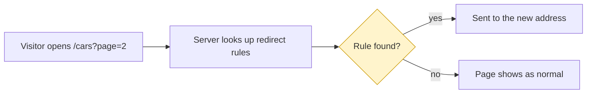

# Debrief template

Keep section titles exact; `check_debrief.py` checks them and their order.

- Required, in this order: Bottom line, How it works, Decisions you own, Left undone on purpose, Questions you would ask next, Dig deeper.
- Optional, after Left undone on purpose: What changed, Status board, Say it to your lead, Words used here. Add one only when the session needs it (see "When to add" below).
- Budget: 900 words plus 140 per decision card, at most 1,600, chart not counted. About 110 lines. Do not delete a required distinction to clear a warning.

The skeleton is inside a four-backtick fence so the inner Mermaid fence shows. Do not copy the outer fence. Delete the italic guidance.

````markdown
# Debrief: <topic in the user's words>

Session `<uuid>` · <cursor | kiro> · <project or cwd> · <session dates>

## Bottom line

<Plain answer to the user's real question. For a review: Yes or No on each claim, which values to add, which to leave, and whether each claim was introduced or already there.> <What is true now, including what happened after the session.> <The one thing the user must do or decide.>

*At most 3 sentences and 70 words. The sentences are the answers, not a retelling. No commit hashes.*

## How it works

<Plain answer block, up to 140 words. One concrete example from the session. For a design question cover: why the thing exists, when it runs, who reads it, whether it was needed before. Explain a term in brackets the first time.>



*At most 12 nodes, plain-language labels, no tool names. The red box is the constraint (what cannot be done), beside the normal path. Each recommended option, in its card, says what it still does not fix. For a design question, name the visitor-visible effect here: status code, failure, cache. Chart the session timeline only when the confusing part is what the agent did.*

## Decisions you own

### 1. <The decision as a plain question>

<Why it matters to you, one or two sentences.>

| Option | What happens next | Undo? |
|--------|-------------------|-------|
| A. <short> | <consequence, and what it does not fix> | yes / hard / no |
| B. <short> | <consequence, and what it does not fix> | yes / hard / no |

**Recommendation:** <A or B>, because <one reason>.
**If you do nothing:** <the default outcome>.
**Do it if:** <condition>.
**Skip it if:** <condition>.
**Where this came from:** <your instruction | design | code | reviewer | vendor | the agent's own choice | a later commit by <git author>>, <file:line or turn>.

*At most 4 cards, most urgent first. Only decisions still open today. A card that asks for input can drop the table. If none: "No decisions are waiting on you."*

## Left undone on purpose

| Item | Status now | Agent's reason |
|------|------------|----------------|
| <plain words, one example> | open / closed by <commit or later session> | "<short quote>" (turn n or subagent n) |

- **<open item>**: <what breaks if left>. Do it if <condition>; skip it if <condition>.

<One line per thing the agent said is not a gap: what it relates to and why it is not a gap.>

*Include items only a subagent reported. Or write "Nothing was left undone on purpose."*

## Questions you would ask next

**<Question in the user's voice?>**
<Answer first, one to three sentences. Mark unverified answers "(not checked)".>

*4 to 7 questions. The "Must also cover" items for the session type come first.*

## Dig deeper

- `<copy-paste prompt naming the session id and one precise question>`

*Two to four prompts.*
````

## When to add the optional sections

| Section | Add when |
|---------|----------|
| `## What changed` | The session edited files or commits. Table: file or artifact, why, kind (required, extra, introduced, pre-existing, removed). Say what replaced anything removed. Branch and commit names go here. |
| `## Status board` | The user asked for three or more deliverables. Columns: item, ✅ / ⚠️ / ❌ / ❓, how we know (verified: command or file, or reported: turn n). |
| `## Say it to your lead` | The work will be reviewed or reported to someone else. One paragraph the user can paste. |
| `## Words used here` | More than three terms need explaining and brackets would clutter the text. At most 12. |
