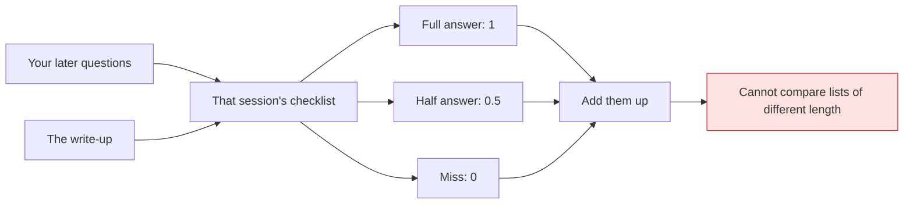

# Debrief: what those scores mean

Session `sess_e7e2788f-6dc0-4e8e-9623-c448e856d6e5` · kiro, finished in this Cursor chat · `/home/dev/ai-system` · 8 Nov 2026

## Bottom line

A score counts how many of your later questions that write-up already answered: a full answer is 1, a half answer is 0.5, and a miss is 0. The 6.5 out of 7 means six button-comment questions were answered and one was only half answered, whether to add `comingSoonForm`. The 7, the 6, and the 14 are three different question lists, so those fractions are not the same exam.

## How it works

The button-comment write-up that scored 2.5 out of 7 had seven asks. It fully answered one (1), half-answered three (1.5), and missed three (0).

A half answer names the topic and drops the part you needed. On the last pass the half was `comingSoonForm` [the coming-soon drawer action]: the write-up said leave it out, and your follow-up said adding it was reasonable.

The red limit is the list length. The JSON-file list was six asks (4 full + 2 half = 5). The overlay list was fourteen points (7 full + 5 half + 2 miss = 9.5). A 5 out of 6 is not better than a 6.5 out of 7.

Rovo [the reviewer bot on that pull request] is the name of the seven-ask list, not a review of this scoring chat.

## Decisions you own

### 1. Should 6.5 out of 7 decide whether the skill is ready?

The number says the last Rovo write-up would have saved you six of the seven questions. It does not say the skill is 93 percent finished, and it does not grade the button code.

| Option | What happens next | Undo? |
|--------|-------------------|-------|
| A. Treat 6.5 as "good enough to read" | You still approve install separately. It does not fix the `comingSoonForm` half answer | yes |
| B. Block on the half point | One value call gets rewritten. It does not raise the Yoast or overlay lists by itself | yes |

**Recommendation:** A, because the half point is one name, not a failed explanation.
**If you do nothing:** the draft stays uninstalled, which was already true.
**Do it if:** you wanted to know whether the write-up understood the Rovo chat.
**Skip it if:** you are deciding install location. That choice is not in these fractions.
**Where this came from:** the agent's own choice, this chat's score of the Rovo retest.

## Left undone on purpose

| Item | Status now | Agent's reason |
|------|------------|----------------|
| Yoast visitor effects: a 301 sent as 308, any other type as 307, and no long-lived cache header | open | "5 out of 6 was enough to stop another full round" (this chat) |
| Overlay: order hints, intro height, and three of the four "not a gap" items | open | "the score held at 9.5, so no fourth round" (this chat) |

- **Yoast visitor effects**: a reader still has to ask what Google receives. Do it if you want that design debrief to answer the SEO question; skip it if you only needed the scoring explained.
- **Overlay leftovers**: two real gaps and three "leave these alone" lines are still absent. Do it if you will use the skill on big multi-agent builds; skip it if your next use is a short review like Rovo.

The different denominators are not a gap. They are the checklist lengths.

## Questions you would ask next

**So 6.5 out of 7 means the skill is almost done, right?**
No. It means that one practice write-up answered 6.5 of the 7 questions in the Rovo follow-up. The skill itself is a draft until you approve it.

**What does a half point look like?**
On the last Rovo pass, "which values do I add?" was the half. Leaving `white` out was right. Saying never add `comingSoonForm` was the missing half, because your follow-up treated that add as reasonable.

**Why did Rovo go 4.5, then 2.5, then 6.5?**
Each number is a new write-up of the same seven questions. 4.5 was the second try. 2.5 was the third, after a tight word cap cut the yes/no lines. 6.5 is the fourth, after those lines were required again.

**Is 5 out of 6 better than 6.5 out of 7?**
No. Five out of six means four Yoast questions were full and two were half (status codes and the flowchart). Six and a half out of seven is a different list. Compare a list only with its own earlier round: Yoast went 2, then 3.5, then 5.

**Did you check this, or is it reported?**
The arithmetic is verified from the grade files: Yoast is 4 + 1.0, overlay is 7 + 2.5, and the last Rovo pass is 6 + 0.5. I did not re-open the three product repos for this explanation.

**What is still unanswered on the overlay?**
Order hints and the intro staying 616px tall were missed. The shared reason was only half quoted. Three "not a gap" items were absent, and one was marked open when it should have been left alone.

**So the number is a checklist, not a school grade, right?**
Right. Add the points on that session's own list. Do not turn the fraction into a percent and compare it with another session.

## Dig deeper

- `Using session sess_e7e2788f, walk the seven Rovo asks one by one and say answered, half, or missed for the 6.5 write-up only.`
- `Using session 7e14dc84, explain the two Yoast half points in plain words: status codes and the flowchart.`
- `Using session 70677439, list the fourteen overlay points as answered, half, or missed, one line each.`
