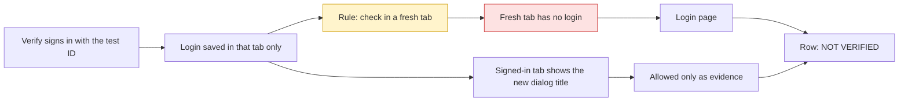

# Debrief: what went wrong in today's NSS-4 run of the ticket workspace

Session `8af67013-1a24-4929-9e83-86e498b6650e` · cursor · `/home/dev/ai-system` · 9 Nov 2026

## Bottom line

No, the workspace cannot pass a login-gated ticket; the 13:39 update introduced that, while the model and write problems were already there. Yes, the NSS-4 change works when signed in, but its report says 0 of 4 and the handoff is stale. Decide how to treat NSS-4, and check the real requests verify submitted.

## How it works

NSS-4 changes the title of the dialog shown after you send a form. To see it, verify must sign in with an ID and a one-time code (OTP). This app keeps the login in `sessionStorage` [storage that belongs to one browser tab]. The 13:39 rule passes a row only in a fresh tab with no session this run made. A fresh tab has no login, so every row stays NOT VERIFIED, even when the signed-in tab shows the right title.

## Decisions you own

### 1. Is NSS-4 ready to approve?

The change works in the signed-in tab, but the pipeline's own records say it does not.

| Option | What happens next | Undo? |
|--------|-------------------|-------|
| A. Read the evidence yourself, then `approve NSS-4` | Commits and pushes now. The records still say 0 of 4 and the handoff still says "not ready" | hard |
| B. Fix the login rule first, then rerun 05 and 06 | The records match reality before you push. Costs one more verify run | yes |
| C. Sign in yourself on port 3000 and send one form | You see it with your own eyes. Does not fix the records | yes |

**Recommendation:** C, then B, because the pipeline should be able to pass this kind of ticket before you trust its next "ready".
**If you do nothing:** the run waits at the handoff, with a message that is out of date.
**Do it if:** you want a pipeline that can pass login-gated tickets.
**Skip it if:** NSS-4 is urgent; then do C and approve.
**Where this came from:** the third verify, `stages/05-verify/output/NSS-4/verify-report.md` rows 1, 2 and 4.

### 2. Do the requests that verify submitted need cleaning up?

Verify sent the change-bank-account form and the insurance-fund form for identity 017460544. The replies said "request created, a representative will call you back". Whether that backend is a test system was not checked.

**Recommendation:** ask whoever owns the backend whether those two requests reached a real queue, and cancel them if so.
**If you do nothing:** a representative may act on a test request.
**Do it if:** the backend is shared or real.
**Skip it if:** the backend is confirmed as a test system.
**Where this came from:** the agent's own choice, verify subagent `49b1f62c`, steps 24 to 29.

### 3. How should the login rule change?

| Option | What happens next | Undo? |
|--------|-------------------|-------|
| A. Allow a pass in the signed-in tab, after a test login written down per repo | Works for `sessionStorage` apps. Does not stop verify from sending forms that create real requests | yes |
| B. Keep "fresh tab only" and keep a profile signed in before the run | Fails for this app, because a new tab drops the login | yes |
| C. Leave it | Every login-gated ticket ends "not ready" | yes |

**Recommendation:** A, plus a plan line that says whether sending a form is safe.
**If you do nothing:** the next NSS ticket repeats today's three verify passes.
**Do it if:** you keep running NSS tickets through this workspace.
**Skip it if:** only public pages go through it.
**Where this came from:** design, `stages/05-verify/references/verify-steps.md:25`.

### 4. Should `CLAUDE.md` name a model per stage?

**Recommendation:** yes. Use fast models for intake, handoff and release; the `explore` type for research; the strongest model for plan; and the strongest for implement only when the plan touches more than about three files, auth, payments or shared services. Use a mid model for verify, and move a retried stage up one tier. This does not make a stage smarter, only cheaper where the work is simple.
**If you do nothing:** every stage keeps the parent's model and cost.
**Do it if:** cost or speed matters.
**Skip it if:** you prefer one model for predictable behaviour.
**Where this came from:** your instruction in this session, and the Task tool's "only choose an explicit model when the user directly requests it".

## Left undone on purpose

| Item | Status now | Agent's reason |
|------|------------|----------------|
| Editing the workspace, skills and tools | open | "Recommendations only. Do not edit the skill, tool, or workspace" (session-extract rule) |
| Result of the third verify | closed by the 15:06 report | "still running at 15:03" (turn 1) |
| Cause of the blocked writes | open | "could not confirm from the transcripts whether the sandbox or the security hook did the blocking" (turn 1) |
| What created the NSS-4 worktree before stage 04 | open | "did not find the step where the chat moved into the NSS-4 worktree" (turn 1) |

- **Workspace edits**: the same failures repeat on the next ticket. Do it if you agree with the recommendations; skip it if you plan to redesign verify anyway.
- **Blocked writes**: each stage wastes a retry and writes through the shell. Do it if retries annoy you; skip it if a shell write is fine.
- **Worktree origin**: plan said "create", implement found it existing. Do it if a second run may collide; skip it otherwise.

## Status board

The smaller problems, each separate. "Introduced" means by the 13:39 update; "already there" means older.

| Problem | State | How we know |
|---------|-------|-------------|
| No stage set a model, so all eight subagents ran on the parent's model (already there) | ❌ | verified: no `model` in any Task call, orchestrator steps 4 to 14 |
| Writes to ai-system output folders blocked on the first try in four stages (already there) | ❌ | reported: intake, plan, verify and handoff transcripts |
| Verify read the dev server's environment, against the credential rule (already there) | ❌ | verified: `/proc/134338/environ` command, subagent `50e493e4` step 24 |
| Two subagents wrote their own browser scripts instead of using browser-cdp (already there) | ⚠️ | verified: puppeteer scripts in `4281b70d` and `49b1f62c` |
| `dev_server.py up` leaves a stale process id when it reuses a server (already there) | ❌ | verified: `tools/dev_server.py` lines 154 to 159 |
| `.worktrees/` added twice to the main repo's git exclude (already there) | ❌ | verified: lines 18 and 20 of `.git/info/exclude` |
| `CLAUDE.md` says both "stop after the plan" and "after 03, do not wait" (already there) | ⚠️ | verified: Triggers table vs Orchestrator section |
| The "ready" claim with no running app (fixed by the 13:39 update) | ✅ | verified: orchestrator steps 19 to 29 checked before answering |

## Questions you would ask next

**Does the NSS-4 code change actually work?**
Yes, in the signed-in tab. All three dialogs showed the service's message as the title, including when `IsSuccess` was false with `general_error`. That comes from the verify report; I did not open the screenshots.

**Was the only user pushback the login details?**
Yes. You sent the ID and OTP after the "not ready" handoff. The earlier complaint, a "ready" claim with no running app, did not come back.

**Is a credential exposed?**
The ID and OTP are in two subagent prompts, temp step files and a DOM snapshot. They are test values. The dev server's environment was read and filtered for Turnstile keys; what it printed was not checked.

**Is it safe to push NSS-4 now?**
The diff is three files, nothing staged, on `NSS-4-show-service-response-message` against `dev`. Lint passed. What was not checked: the remote, and the missing space before "Colmobil" in one dialog title, which comes from the service text.

**Which fix matters most?**
The login rule. It caused the three verify passes, the hand-written prompts, and the real form submits.

**Why didn't the orchestrator pick cheaper models itself?**
The Task tool says to pass a model only when the user asks for one. Without a table in `CLAUDE.md`, it always inherits.

## Dig deeper

- `Session 49b1f62c-0b71-4ec6-a0c0-d0096dbc62bc: list every form that was submitted, with the response body for each.`
- `Session 50e493e4-6c93-4db0-8309-d24b6b6d22e6: what did the /proc/134338/environ command print?`
- `Session 35a76822-f182-45ff-ad00-153a5da1fbcb: did the orchestrator post a new handoff after the third verify?`
